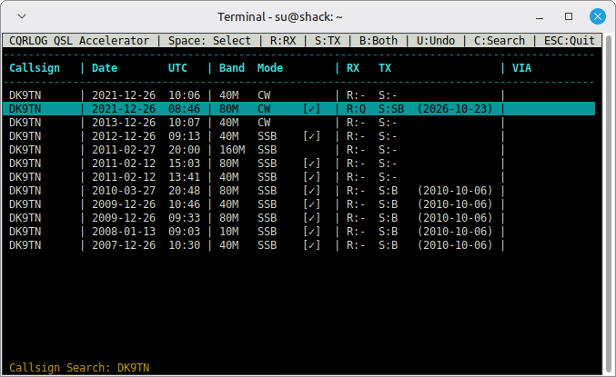

# CQRLOG QSL Accelerator

A lightning-fast, keyboard-driven terminal tool (TUI) for Linux to efficiently process incoming paper QSL cards in **CQRLOG**. Instead of clicking through the GUI or using multiple CTRL+somethings, you can search for callsigns using fuzzy search and set QSL flags for the bureau export with a single keystroke.



## Prerequisites
* **Linux** (e.g., Linux Mint, Ubuntu, Debian)
* **Python 3**
* The **PyMySQL** module (system package recommended to avoid conflicts)

## Installation

1. Download the script via the green "Code" button (Download ZIP) and extract it, or clone the repository directly via the terminal:
   ```bash
   git clone https://github.com/YOUR-USERNAME/cqrlog-qsl-accelerator.git
   cd cqrlog-qsl-accelerator
   ```

2. Install the MySQL driver for Python (for Debian/Ubuntu/Mint-based systems):
   ```bash
   sudo apt update
   sudo apt install python3-pymysql
   ```

3. Make the script executable:
   ```bash
   chmod +x cqrqsl.py
   ```

## Configuration (Adjusting the Log Number)
By default, the script is configured for **Log No. 1** (`cqrlog001`). 
If you want to process QSL cards for a different logbook (e.g., Log No. 2), open the file `cqrqsl.py` in any text editor and adjust the database name in the configuration block at the top:

```python
# --- DATABASE CONFIGURATION ---
DB_NAME = 'cqrlog002'  # Change for Log No. 2, 3 etc.
```

## ⚠️ Important: CQRLOG must be running!
This script directly accesses CQRLOG's local MySQL/MariaDB database (usually via port 64000). **CQRLOG must be open in the background** so that the database server is active and the script can establish a connection.

## Usage

1. **Start CQRLOG normally** (and minimize it if you like).
2. Open a terminal and run the script:
   ```bash
   ./cqrqsl.py
   ```
3. **Keybindings inside the tool:**
   * **`C`** - Search for a new callsign. The search tolerates slight typos (fuzzy search).
   * **`Spacebar`** - Selects/marks the current QSO. (You can select multiple QSOs in a row using the spacebar).
   * **`R`** *(Received)* - Marks **only as received** (sets `qsl_r = 'Q'` and today's date).
   * **`S`** *(Send)* - Marks **only to send via bureau** (sets `qsl_s = 'SB'` and today's date). Ideal for band/mode combinations you want to send a card for without logging a received card.
   * **`B`** *(Both)* - Marks **Both** (logs as received + queues to send via bureau).
   * **`U`** *(Undo)* - **Undo changes.** If you made a mistake, this reverts all QSL flags and date stamps of the selected QSO to the exact state it had before the current search.
   * **`ESC`** - Quit the script.

*Tip:* Band/mode combinations that have already been confirmed in the past (whether received by you or previously sent via bureau/direct) are automatically marked with a **`[✓]`** in the search results for easy orientation.  

4. **Further Processing & Export:** Once you are done marking your QSOs in the terminal, return to the CQRLOG GUI. You can now use the standard CQRLOG QSL export menu to filter, sort, auto-add QSL Managers and export your queued QSLs (e.g., to print labels using gLabels or similar software).
